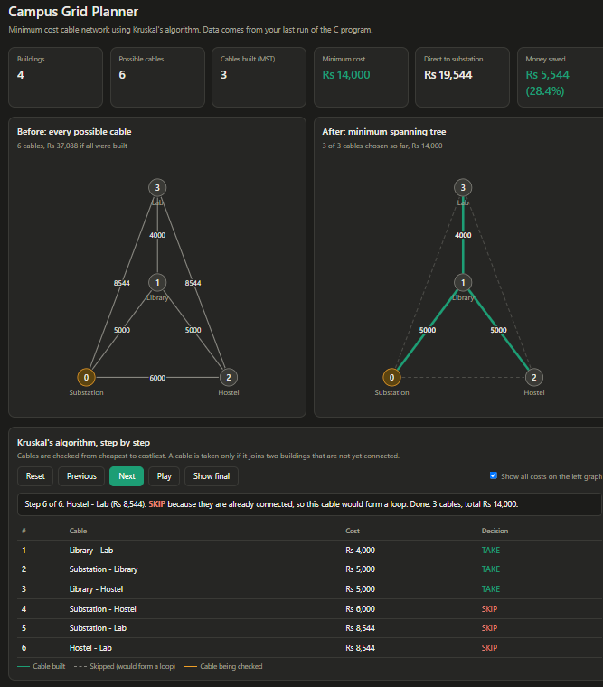

# Campus Grid Planner


A Data Structures and Algorithms project that plans the **lowest-cost electricity cable network** for the buildings of a campus. The campus is modelled as a weighted graph and the cheapest network is found with **Kruskal's Minimum Spanning Tree algorithm**, written in C. A browser dashboard shows the result visually.

**Task 32: Electricity / Grid Connection Planner**

---

## The problem

A campus has a substation and several buildings. A cable can be laid between any two buildings, but a longer cable costs more. Which cables should be built so that **every building is powered** and the **total cost is as low as possible**?

## How it is modelled

| Real world | Graph concept |
|---|---|
| Building | Vertex |
| Possible cable between two buildings | Edge |
| Cable cost (distance x cost per meter) | Edge weight |
| Cheapest network that connects every building | Minimum Spanning Tree (MST) |

A spanning tree of V buildings has exactly **V - 1** cables and **no loops**. A loop would mean at least one cable that is not needed.

## Algorithm: Kruskal's

1. Create every possible cable (one for each pair of buildings) and compute its cost.
2. Sort the cables from cheapest to costliest.
3. Go through them in order. If the two buildings are **not yet connected**, build the cable. If they are already connected, **skip** it, because it would form a loop.
4. Stop when all buildings are connected.

**Loop detection** uses **Union-Find** (a `parent[]` array with path compression). Each building belongs to a group, and a cable is taken only if its two buildings are in different groups.

## Features

- Takes any number of buildings (up to 20) with their positions in meters
- Calculates cable cost from real distances using the distance formula
- Finds the minimum cost network with Kruskal's algorithm and Union-Find
- Compares the result with the naive layout (every building wired directly to the substation) and shows the money saved
- Saves the result so a **browser dashboard** can draw it:
  - Before graph (all possible cables) and after graph (the minimum spanning tree)
  - Summary cards with the costs and savings
  - A step-by-step mode that shows Kruskal's taking or skipping each cable

## Project files

| File | Purpose |
|---|---|
| `grid_planner_dashboard.c` | The C program (input, Kruskal's, Union-Find, comparison, data export) |
| `dashboard.html` | The dashboard, opened in a web browser |
| `plan.js` | Result data written by the C program and read by the dashboard (a sample is included) |

## How to run

**You need:** a C compiler (gcc) and a web browser.

1. Compile:
   ```
   gcc grid_planner_dashboard.c -o grid.exe -lm
   ```
2. Run:
   ```
   .\grid.exe
   ```
   (on Linux or macOS: `gcc grid_planner_dashboard.c -o grid -lm` and `./grid`)
3. Enter the data when asked (see the input format below).
4. Open `dashboard.html` in your browser. Press **F5** after each new run to refresh it.

Keep `dashboard.html` and `plan.js` in the same folder.

### Input format

```
Number of buildings (building 0 = substation)
name x y        (one line per building, x and y in meters)
Cable cost per meter (Rs)
```

Building 0 is always the substation. Do not use spaces in names (use `Hostel_A`).

### Example

Input:
```
4
Substation 0 0
Library 30 40
Hostel 60 0
Lab 30 80
100
```

Output:
```
--- Cables to build (minimum cost) ---
Library <-> Lab : Rs 4000
Substation <-> Library : Rs 5000
Library <-> Hostel : Rs 5000
Total minimum cost = Rs 14000

If every building is wired directly to the substation: Rs 19544
Money saved = Rs 5544 (28.4%)
```

## Complexity

Let V be the number of buildings and E the number of possible cables (E = V(V-1)/2).

| Part | Time |
|---|---|
| Creating the cables | O(V^2) |
| Sorting the cables (bubble sort, as implemented) | O(E^2) |
| Kruskal's loop with Union-Find | almost O(E) |

With a faster sort such as `qsort`, the total becomes the standard **O(E log E)** for Kruskal's. Bubble sort is used here to keep the code simple, which is fine for a campus-sized input.

**Space:** O(E + V) for the cable list and the `parent[]` array.

## Limitations and future work

- Distances are straight lines. Real cable routes depend on roads, terrain and existing trenches.
- An MST has **no backup**: if one cable fails, part of the campus loses power. A future version can find the cheapest backup cable for every planned cable.
- Cables that are already built could cost zero and be merged first.
- Prim's algorithm could be added to compare running times on larger inputs.
- Steiner points (extra junctions) can reduce the cost further.

## Concepts used

Graphs, weighted edges, spanning trees, minimum spanning trees, greedy algorithms, Kruskal's algorithm, Union-Find (disjoint sets) with path compression, sorting, structures and arrays in C, file output.

## Author

Vrishab: Data Structures and Algorithms project
